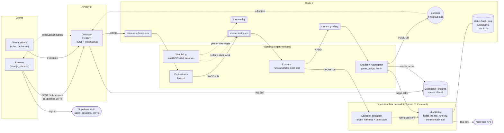
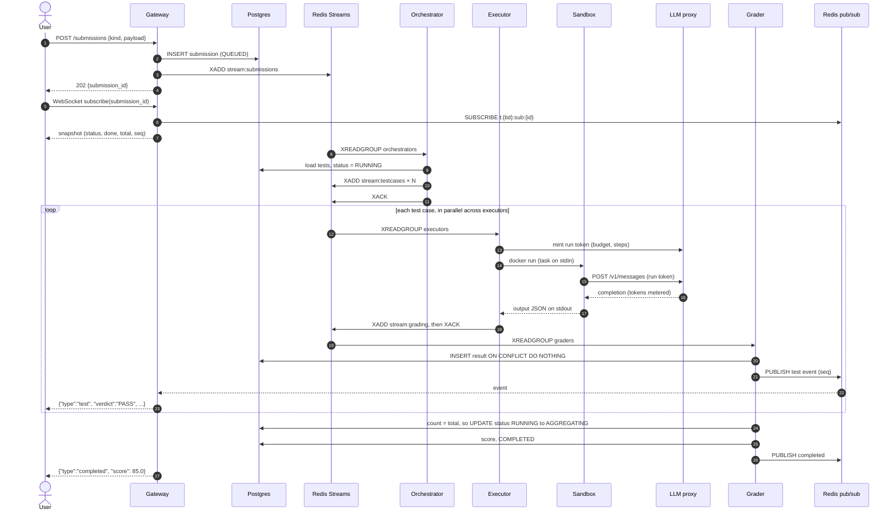
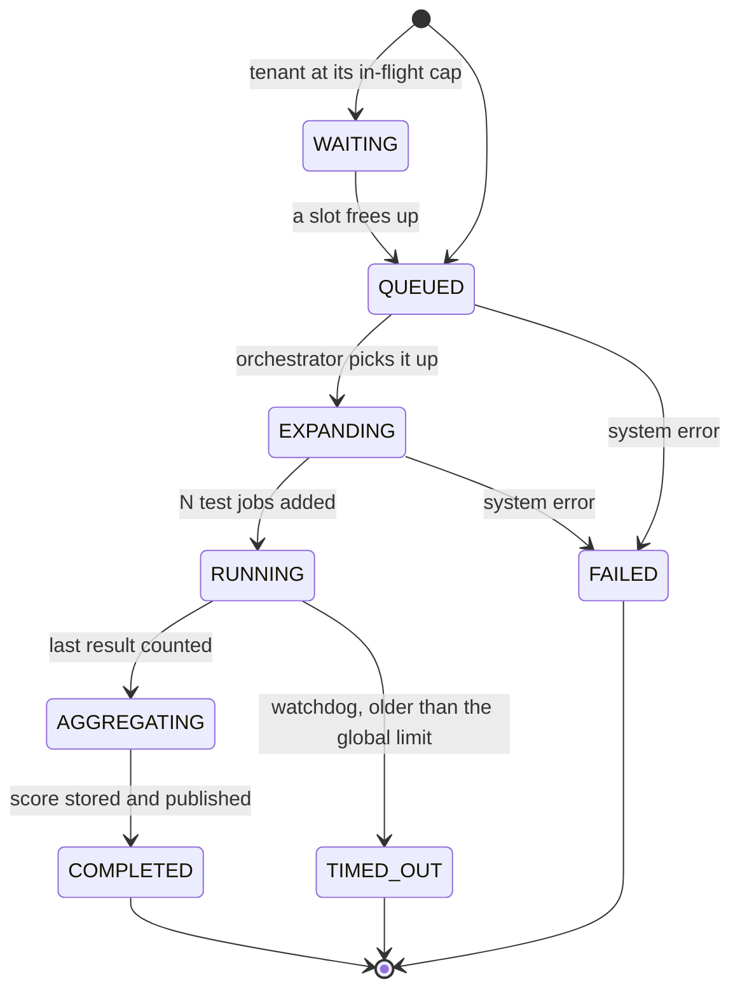
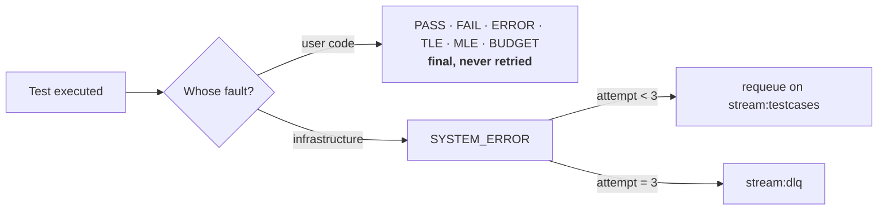
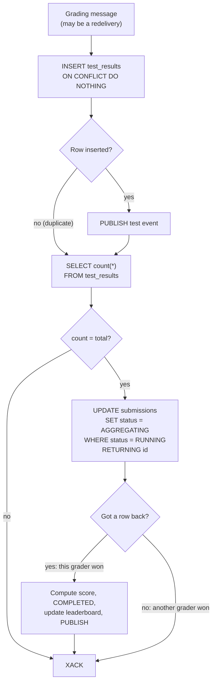
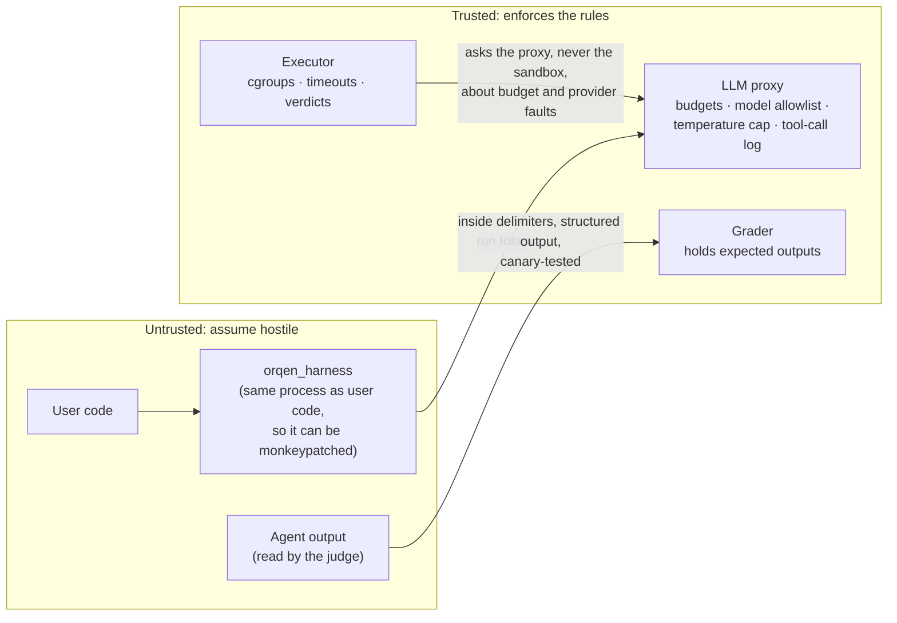
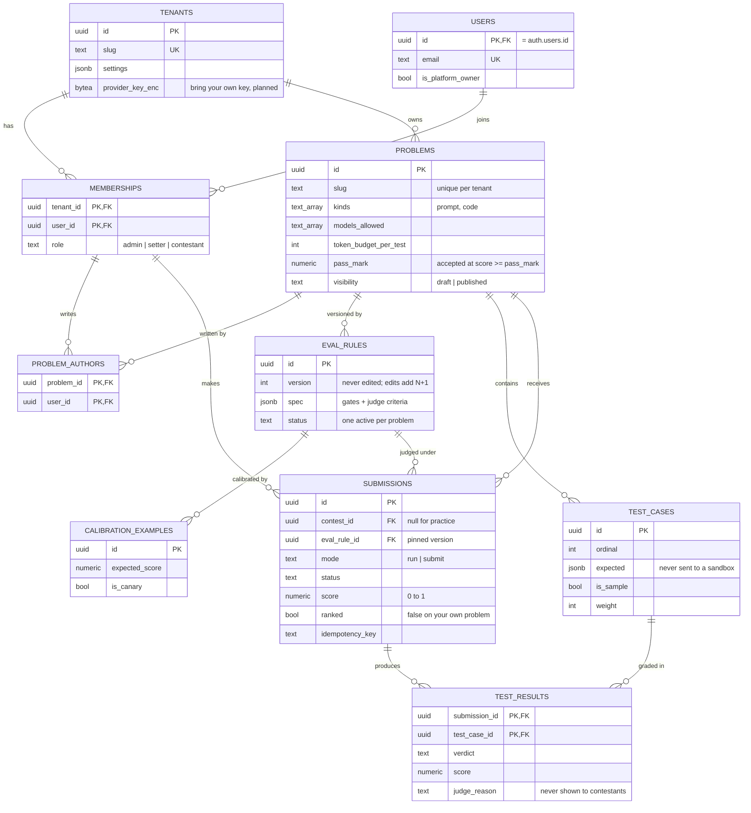
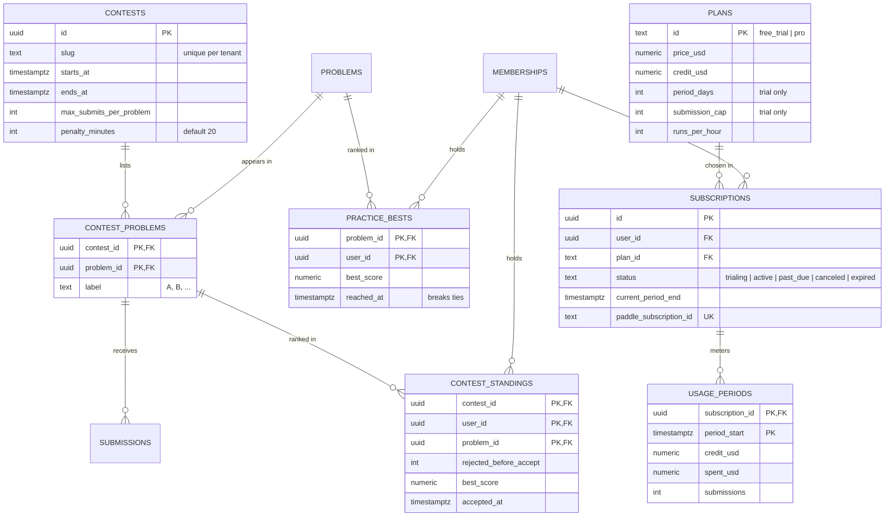
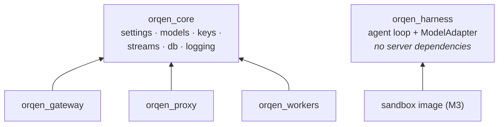
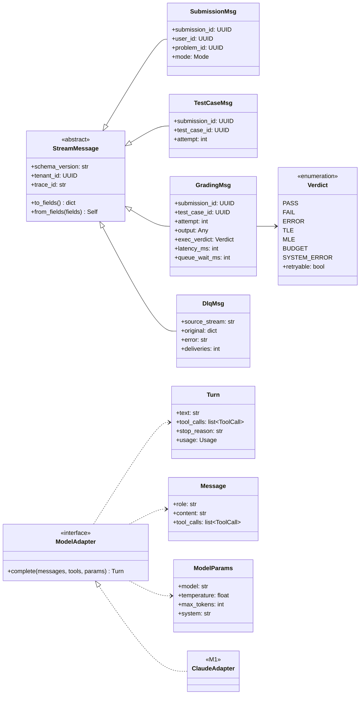

# Orqen

[](https://github.com/priyanshu14077/orqen/actions/workflows/ci.yml)

**An online judge for AI agents, like Codeforces but for agents.** Setters publish problems with versioned eval rules. Contestants submit a **prompt spec** or **agent code**, in the practice archive or in timed contests. Every test case runs in a Docker sandbox with no network access except a metering LLM proxy. Work moves through Redis Streams, Postgres decides when a submission is complete, and results stream to the browser over WebSockets.

> **Status:** the foundation is built: workspace, schema, seed, stream setup and CI. The diagrams show the target design. Parts that aren't built yet are marked *planned*.

---

## Contents

1. [How a classic judge maps to an AI judge](#1-how-a-classic-judge-maps-to-an-ai-judge)
2. [System architecture](#2-system-architecture)
3. [Submission lifecycle](#3-submission-lifecycle)
4. [Submission states](#4-submission-states)
5. [Fan-in: who computes the score](#5-fan-in-who-computes-the-score)
6. [Trust boundaries](#6-trust-boundaries)
7. [Data model](#7-data-model)
8. [Code structure](#8-code-structure)
9. [Redis keyspace and streams](#9-redis-keyspace-and-streams)
10. [Set up and run](#10-set-up-and-run)
11. [Conventions](#11-conventions)
12. [Design decisions](#12-design-decisions)

---

## 1. How a classic judge maps to an AI judge

| Codeforces | Orqen |
|---|---|
| Source file | A prompt spec, or `agent.py` exposing `solve(task, llm, tools)` |
| Compiler and runtime | Sandbox image running the Orqen agent loop (`orqen_harness`) |
| Test input on stdin | Task JSON |
| Checker | Eval rule: deterministic gates first, then an optional LLM judge |
| Time limit, memory limit | Same, enforced by cgroups |
| *(no equivalent)* | **Token budget and step cap**, enforced by the LLM proxy |
| No network | No network except one route: the LLM proxy |
| Same input, same verdict | Not guaranteed, so admins pin temperature and can repeat tests |
| Judging is free | Every test costs tokens, so the provider quota limits throughput |

---

## 2. System architecture



The **executor scales horizontally**: adding executors increases throughput until the provider quota, enforced in the proxy, becomes the limit.

---

## 3. Submission lifecycle



A worker acks a message (`XACK`) only after its output is durable: either the next `XADD` succeeded or the Postgres row is committed.

---

## 4. Submission states



Verdicts for each test case:



---

## 5. Fan-in: who computes the score

Results arrive in any order, and some arrive more than once. Exactly one grader must aggregate. Postgres makes that decision, and the Redis counter only shows progress. [Postgres decides when a submission is complete](#postgres-decides-when-a-submission-is-complete) explains why.



Because the count runs on every delivery, a redelivery after a crash still completes the submission.

---

## 6. Trust boundaries



Rules that follow from this:

- **The real provider key never enters a sandbox.** In the sandbox, `ANTHROPIC_API_KEY` is a single-use run token and `ANTHROPIC_BASE_URL` points at the proxy.
- **Expected outputs never enter a sandbox.**
- **Hidden tests return only verdicts and scores.** Users never see stdout, traces or judge reasons for hidden tests, because any of them could quote the hidden input.
- **Trajectory grading uses the proxy's log of tool calls.** Anything the sandbox reports about itself can be faked.

---

## 7. Data model

Built by migrations `0001` to `0004`. Tables are grouped into one Postgres schema per feature, and code always names a table with its schema, such as `judging.submissions`. Only `alembic_version` stays in `public`.

| Schema | Tables | Holds |
|---|---|---|
| `identity` | `tenants`, `users`, `memberships` | Who someone is and their role: `admin`, `setter` or `contestant` |
| `authoring` | `problems`, `problem_authors`, `eval_rules`, `calibration_examples`, `test_cases` | What setters write |
| `judging` | `submissions`, `test_results` | What contestants send and how it scored |
| `competition` | `contests`, `contest_problems`, `contest_standings`, `practice_bests` | Contests and both leaderboards |
| `billing` | `plans`, `subscriptions`, `usage_periods`, `model_prices`, `paddle_events` | Plans, credit and Paddle webhooks |
| `ops` | `llm_usage`, `audit_log` | Append-only records |

Every table owned by a tenant has a `tenant_id`, and each child table references its parent by `(tenant_id, id)`. That composite foreign key makes it impossible to point at another tenant's row. Orqen runs as one platform in a single tenant today, and the tenant columns let organisations be added later without a schema rewrite. `billing.plans`, `billing.model_prices` and `billing.paddle_events` are platform-wide and have no `tenant_id`.

The roles nest: an admin can do everything a setter can, and a setter everything a contestant can.

### Authoring and judging



The primary key of `TEST_RESULTS` is what removes duplicates during fan-in. A submission to a problem in `PROBLEM_AUTHORS` for the same user is stored with `ranked = false` and never reaches a leaderboard.

### Competition and billing



The primary key of `TEST_RESULTS` is what removes duplicates during fan-in. The application role `orqen_app` can only insert into `LLM_USAGE` and `AUDIT_LOG`, never update or delete.

---

## 8. Code structure

### Package dependencies



`orqen_harness` deliberately depends on nothing server-side, so the sandbox image installs it without Postgres drivers, Redis clients or secrets.

### Core types (UML)



### Repository layout

| Path | What it is |
|---|---|
| `packages/core` | `orqen_core`: settings, domain enums, stream payloads, the Redis keyspace, DB helpers, logging |
| `packages/harness` | `orqen_harness`: the agent loop and model adapters |
| `services/gateway` | Auth, submissions, WebSocket live updates |
| `services/proxy` | The LLM proxy: holds the real provider keys, meters and limits every call |
| `services/workers` | One `orqen-workers` command for the orchestrator, executor, grader and watchdog |
| `sandbox/` | The sandbox image (M3) |
| `web/` | The frontend (M8) |
| `migrations/` | Alembic migrations, written by hand. Autogenerate is not used |
| `scripts/seed.py` | Dev seed that is safe to rerun |
| `infra/` | Postgres init scripts for compose |

---

## 9. Redis keyspace and streams

| Stream | Consumer group | Payload |
|---|---|---|
| `stream:submissions` | `orchestrators` | `SubmissionMsg` |
| `stream:submissions:priority` | `orchestrators` | `SubmissionMsg` ("Run on samples" lane) |
| `stream:testcases` | `executors` | `TestCaseMsg` |
| `stream:grading` | `graders` | `GradingMsg` |
| `stream:dlq` | `operators` | `DlqMsg` |

| Key | Type | Purpose |
|---|---|---|
| `t:{tid}:sub:{id}:status` | hash | Snapshot sent to a client when it connects or reconnects |
| `t:{tid}:sub:{id}:seq` | int | Sequence number for events, so clients can drop duplicates |
| `t:{tid}:sub:{id}` | pub/sub | Live events for one submission |
| `t:{tid}:sub:{id}:remaining` | int | Progress display only |
| `t:{tid}:inflight` | int | Per-tenant admission cap |
| `t:{tid}:lb:{problem_id}` | zset | Leaderboard |
| `run:{token}` | hash | Per-run credential and budget, read by the proxy |
| `ws:ticket:{ticket}` | string | One-time WebSocket auth ticket, valid for 30s |

The WebSocket snapshot race is handled in this order: subscribe first, then read the snapshot (including `seq`), then forward only events with a higher `seq`.

---

## 10. Quick start

You need Docker, [uv](https://docs.astral.sh/uv/) and Python 3.12. uv downloads Python if it's missing.

```sh
cp .env.example .env
make install
make setup        # start Postgres + Redis, migrate, seed, create stream groups
make check        # ruff, mypy, tests: the same checks CI runs
make gateway      # http://localhost:8000/readyz
```

`make help` lists every target. Postgres listens on host port **5433** and Redis on **6380**, so they don't collide with other local instances. Change `ORQEN_PG_PORT` and `ORQEN_REDIS_PORT` in `.env` if needed.

Seeded logins, all with password `orqen-dev-password`:

| Email | Role |
|---|---|
| `owner@orqen.test` | Platform owner |
| `admin@acme.test`, `admin@globex.test` | Tenant admin |
| `member@acme.test`, `member@globex.test` | Member |

---

## 11. Conventions

- **Redis keys and stream names** come only from `orqen_core.keys` and `orqen_core.streams`.
- **Stream payloads** are `StreamMessage` subclasses, stored as `{v, data}`. Bump `schema_version` when a payload changes shape.
- **Enums and SQL CHECK constraints** are defined in both places. `tests/unit/test_models.py` fails if they drift apart.
- **Tenant-scoped queries** run inside `orqen_core.db.tenant_tx`, which switches to the non-owner `orqen_app` role and sets `app.tenant_id` for that transaction only.
- **Logs** are JSON lines. `trace_id` arrives in the `X-Trace-ID` header and travels in every stream payload.
- **Migrations** are hand-written SQL. Never autogenerate them: autogenerate would silently drop the CHECK constraints, partial indexes and RLS policies.

---

## 12. Design decisions

### Redis Streams carry the work, pub/sub carries live events

A test job must survive a worker crash. With Redis lists (`LPUSH` and `BRPOP`), a popped message is gone, so a worker that crashes mid-job loses it. A stream with a consumer group keeps each message in the pending entries list until a worker runs `XACK`. The watchdog can then reclaim the message with `XAUTOCLAIM`, and the delivery count sets the retry limit.

Kafka also gives these guarantees, but it adds partitions, retention settings and a second system to run. Orqen needs Redis anyway for counters, rate limits and pub/sub, so Kafka buys nothing at this scale.

All tenants share one set of streams, and every payload carries `tenant_id`. Per-tenant streams were rejected: each worker would read N streams, and fairness would still need its own logic. M7 handles fairness with a per-tenant admission cap instead.

Delivery is at least once, so every consumer must be idempotent. Redis runs with AOF (`appendfsync everysec`), so a Redis restart doesn't drop unacknowledged entries. Live progress uses pub/sub. Pub/sub can drop messages, which is acceptable because Postgres and the status hash hold the real state.

### Orqen runs its own agent loop

`orqen_harness` contains the agent loop. The loop calls the model, runs the tool calls the model asks for, and repeats until the model returns a final answer or reaches `max_steps`. The loop talks to the model only through the `ModelAdapter` protocol, and Claude is the first adapter. The LLM judge uses the same adapter for a single call with structured output.

The original plan used Google ADK. ADK's runner, sessions and evaluator are built for one developer testing one agent. Orqen needs a small loop that it can audit, that works with any provider, and that is metered at the proxy. ADK meters through callbacks that run in the same process as user code, and user code can monkeypatch them.

Because the loop runs inside the sandbox, Orqen treats the harness as untrusted too. The proxy enforces the budgets, the model allowlist and the temperature cap, and it records every tool call. To add a provider, write an adapter and a matching translation in the proxy.

### Postgres decides when a submission is complete

N test results reach the graders in any order, and some arrive more than once. Exactly one grader must compute the final score.

The obvious designs write to two systems in a row: `HSETNX` and then `HINCRBY`, or `INSERT` and then `DECR`. If a grader crashes between the two writes, the counter never reaches zero. Redelivery doesn't fix it, because the first write already happened and the grader skips the second.

Orqen counts in Postgres instead, on every delivery, including duplicates:

```sql
INSERT INTO test_results ... ON CONFLICT (submission_id, test_case_id) DO NOTHING;
SELECT count(*) FROM test_results WHERE submission_id = $1;
-- If the count equals the total, try to claim aggregation.
-- Only the grader that gets a row back computes the score:
UPDATE submissions SET status = 'AGGREGATING'
 WHERE id = $1 AND status = 'RUNNING'
RETURNING id;
```

A redelivery after a crash runs the count again and completes the submission. The conditional `UPDATE` lets exactly one grader win. Each result costs one extra `count(*)`, which the primary key index serves. Completion no longer depends on Redis agreeing with Postgres.
