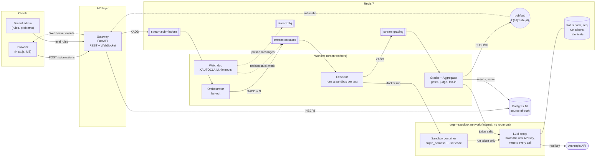
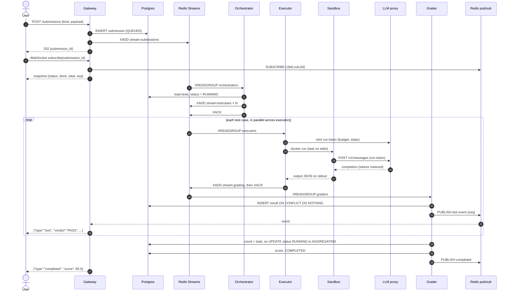
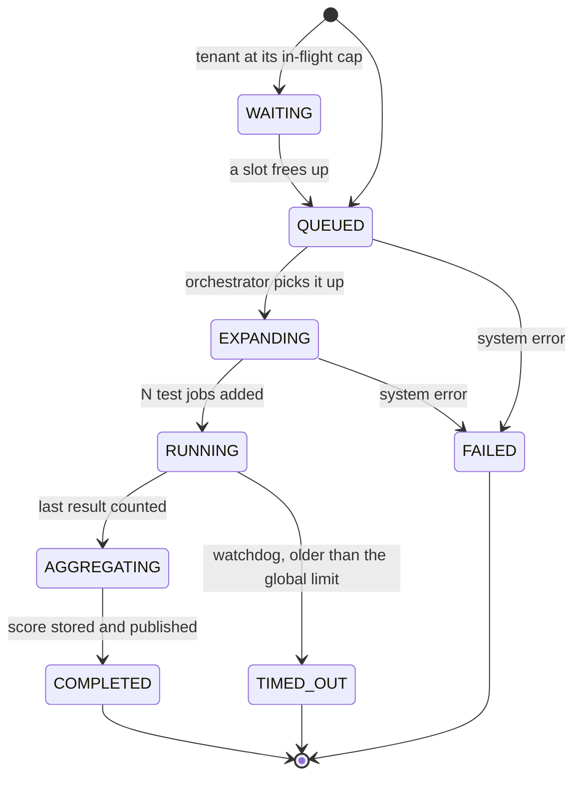
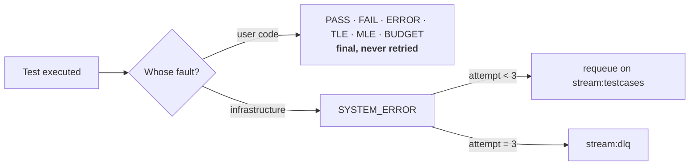
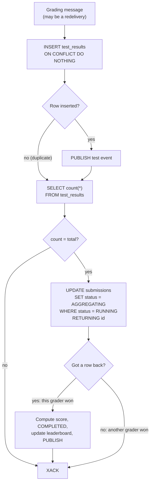
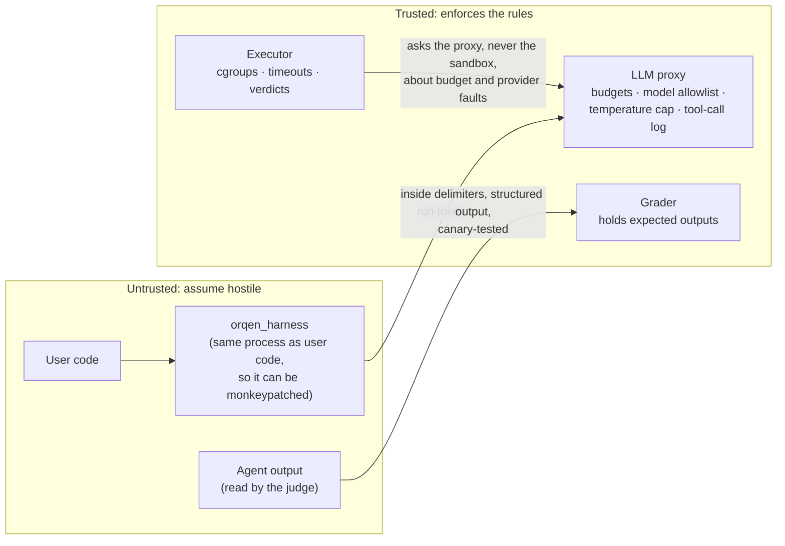
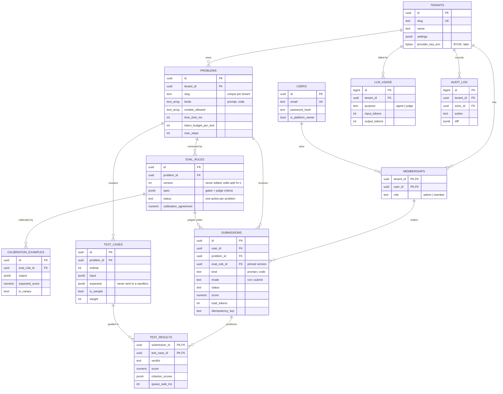
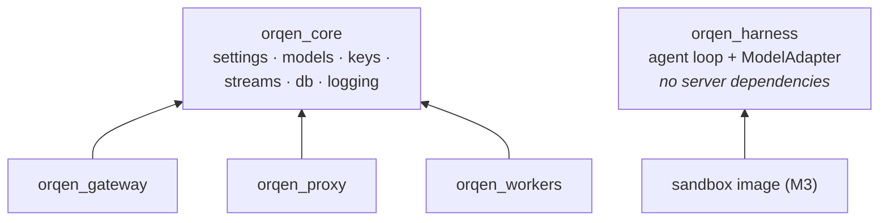
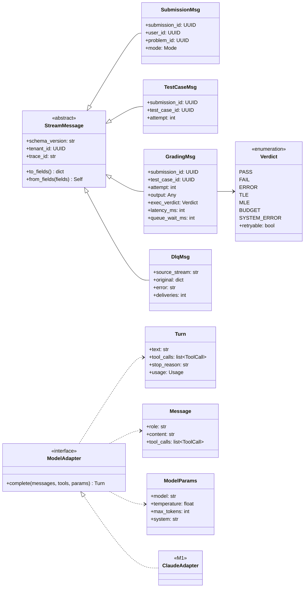
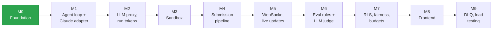

# Orqen

[](https://github.com/priyanshu14077/orqen/actions/workflows/ci.yml)

**An online judge for AI agents, like Codeforces but for agents.** Tenant admins publish problems with versioned eval rules. Members submit a **prompt spec** or **agent code**. Every test case runs in a Docker sandbox with no network access except a metering LLM proxy. Work moves through Redis Streams, Postgres decides when a submission is complete, and results stream to the browser over WebSockets.

> **Status:** M0 (foundation) is merged. The diagrams below show the target design. Parts that aren't built yet are marked with the milestone that adds them.

Product spec: [docs/PRD.md](docs/PRD.md) · Decisions: [docs/adr/](docs/adr/)

---

## Contents

1. [How a classic judge maps to an AI judge](#1-how-a-classic-judge-maps-to-an-ai-judge)
2. [System architecture](#2-system-architecture)
3. [Submission lifecycle](#3-submission-lifecycle)
4. [Submission states](#4-submission-states)
5. [Fan-in: who computes the score](#5-fan-in-who-computes-the-score)
6. [Trust boundaries](#6-trust-boundaries)
7. [Data model](#7-data-model)
8. [Code structure](#8-code-structure)
9. [Redis keyspace and streams](#9-redis-keyspace-and-streams)
10. [Quick start](#10-quick-start)
11. [Conventions](#11-conventions)
12. [Milestones](#12-milestones)

---

## 1. How a classic judge maps to an AI judge

| Codeforces | Orqen |
|---|---|
| Source file | A prompt spec, or `agent.py` exposing `solve(task, llm, tools)` |
| Compiler and runtime | Sandbox image running the Orqen agent loop (`orqen_harness`) |
| Test input on stdin | Task JSON |
| Checker | Eval rule: deterministic gates first, then an optional LLM judge |
| Time limit, memory limit | Same, enforced by cgroups |
| *(no equivalent)* | **Token budget and step cap**, enforced by the LLM proxy |
| No network | No network except one route: the LLM proxy |
| Same input, same verdict | Not guaranteed, so admins pin temperature and can repeat tests |
| Judging is free | Every test costs tokens, so the provider quota limits throughput |

---

## 2. System architecture



The **executor scales horizontally**: adding executors increases throughput until the provider quota, enforced in the proxy, becomes the limit.

---

## 3. Submission lifecycle



A worker acks a message (`XACK`) only after its output is durable: either the next `XADD` succeeded or the Postgres row is committed.

---

## 4. Submission states



Verdicts for each test case:



---

## 5. Fan-in: who computes the score

Results arrive in any order, possibly more than once. Exactly one grader must aggregate. Postgres makes that decision; the Redis counter is only for showing progress ([ADR 0003](docs/adr/0003-postgres-is-fan-in-authority.md)).



Because the count runs on every delivery, a redelivery after a crash still completes the submission.

---

## 6. Trust boundaries



Rules that follow from this:

- **The real provider key never enters a sandbox.** In the sandbox, `ANTHROPIC_API_KEY` is a single-use run token and `ANTHROPIC_BASE_URL` points at the proxy.
- **Expected outputs never enter a sandbox.**
- **Hidden tests return only verdicts and scores.** Users never see stdout, traces or judge reasons for hidden tests, because any of them could quote the hidden input.
- **Trajectory grading uses the proxy's log of tool calls.** Anything the sandbox reports about itself can be faked.

---

## 7. Data model

Built in M0 as migration `0001`. Every table owned by a tenant has a `tenant_id`, and each child table references its parent by `(tenant_id, id)`. That composite foreign key makes it impossible to point at another tenant's row.



The primary key of `TEST_RESULTS` is what removes duplicates during fan-in. The application role `orqen_app` can only insert into `LLM_USAGE` and `AUDIT_LOG`, never update or delete.

---

## 8. Code structure

### Package dependencies



`orqen_harness` deliberately depends on nothing server-side, so the sandbox image installs it without Postgres drivers, Redis clients or secrets.

### Core types (UML)



### Repository layout

| Path | What it is |
|---|---|
| `packages/core` | `orqen_core`: settings, domain enums, stream payloads, the Redis keyspace, DB helpers, logging |
| `packages/harness` | `orqen_harness`: the agent loop and model adapters |
| `services/gateway` | Auth, submissions, WebSocket live updates |
| `services/proxy` | The LLM proxy: holds the real provider keys, meters and limits every call |
| `services/workers` | One `orqen-workers` command for the orchestrator, executor, grader and watchdog |
| `sandbox/` | The sandbox image (M3) |
| `web/` | The frontend (M8) |
| `migrations/` | Alembic migrations, written by hand. Autogenerate is not used |
| `scripts/seed.py` | Dev seed that is safe to rerun |
| `infra/` | Postgres init scripts for compose |

---

## 9. Redis keyspace and streams

| Stream | Consumer group | Payload |
|---|---|---|
| `stream:submissions` | `orchestrators` | `SubmissionMsg` |
| `stream:submissions:priority` | `orchestrators` | `SubmissionMsg` ("Run on samples" lane) |
| `stream:testcases` | `executors` | `TestCaseMsg` |
| `stream:grading` | `graders` | `GradingMsg` |
| `stream:dlq` | `operators` | `DlqMsg` |

| Key | Type | Purpose |
|---|---|---|
| `t:{tid}:sub:{id}:status` | hash | Snapshot sent to a client when it connects or reconnects |
| `t:{tid}:sub:{id}:seq` | int | Sequence number for events, so clients can drop duplicates |
| `t:{tid}:sub:{id}` | pub/sub | Live events for one submission |
| `t:{tid}:sub:{id}:remaining` | int | Progress display only |
| `t:{tid}:inflight` | int | Per-tenant admission cap |
| `t:{tid}:lb:{problem_id}` | zset | Leaderboard |
| `run:{token}` | hash | Per-run credential and budget, read by the proxy |
| `ws:ticket:{ticket}` | string | One-time WebSocket auth ticket, valid for 30s |

The WebSocket snapshot race is handled in this order: subscribe first, then read the snapshot (including `seq`), then forward only events with a higher `seq`.

---

## 10. Quick start

You need Docker, [uv](https://docs.astral.sh/uv/) and Python 3.12. uv downloads Python if it's missing.

```sh
cp .env.example .env
make install
make setup        # start Postgres + Redis, migrate, seed, create stream groups
make check        # ruff, mypy, tests: the same checks CI runs
make gateway      # http://localhost:8000/readyz
```

`make help` lists every target. Postgres listens on host port **5433** and Redis on **6380**, so they don't collide with other local instances. Change `ORQEN_PG_PORT` and `ORQEN_REDIS_PORT` in `.env` if needed.

Seeded logins, all with password `orqen-dev-password`:

| Email | Role |
|---|---|
| `owner@orqen.test` | Platform owner |
| `admin@acme.test`, `admin@globex.test` | Tenant admin |
| `member@acme.test`, `member@globex.test` | Member |

---

## 11. Conventions

- **Redis keys and stream names** come only from `orqen_core.keys` and `orqen_core.streams`.
- **Stream payloads** are `StreamMessage` subclasses, stored as `{v, data}`. Bump `schema_version` when a payload changes shape.
- **Enums and SQL CHECK constraints** are defined in both places. `tests/unit/test_models.py` fails if they drift apart.
- **Tenant-scoped queries** run inside `orqen_core.db.tenant_tx`, which switches to the non-owner `orqen_app` role and sets `app.tenant_id` for that transaction only.
- **Logs** are JSON lines. `trace_id` arrives in the `X-Trace-ID` header and travels in every stream payload.
- **Migrations** are hand-written SQL. Never autogenerate them: autogenerate would silently drop the CHECK constraints, partial indexes and RLS policies.

---

## 12. Milestones



| | Scope | Exit test |
|---|---|---|
| **M0** ✅ | Workspace, compose, schema, seed, CI | `make setup check` passes on a fresh clone |
| M1 | Agent loop with the Claude adapter | Task JSON on stdin gives answer and token usage on stdout |
| M2 | Proxy speaking the Anthropic Messages format, run tokens, budgets, fake provider | Harness works with no real key; an exhausted budget gives `BUDGET` |
| M3 | Sandbox image, one-shot executor | Network, fork-bomb, memory and timeout attacks are all contained |
| M4 | Gateway, orchestrator, executors, deterministic graders, fan-in, watchdog | `kill -9` an executor mid-run; the submission still completes with no duplicate results |
| M5 | WebSocket tickets, pub/sub, `seq`, snapshot | A client on gateway B sees work started through gateway A |
| M6 | Versioned eval rules, gates, judge, calibration and canary checks | An injected output scores low; an uncalibrated rule can't be activated |
| M7 | Row-level security, per-tenant caps and budgets | Cross-tenant reads return nothing; one tenant's flood doesn't delay another |
| M8 | Next.js UI and admin rule editor | Playwright: submit, watch live, see rank |
| M9 | DLQ replay, retries, k6 against the fake provider | 50 × 20-test submissions with p95 under 3 min and nothing lost |
