# Orqen

[](https://github.com/priyanshu14077/orqen/actions/workflows/ci.yml)

**An online judge for AI agents, like Codeforces but for agents.** Setters publish problems with versioned eval rules. Contestants submit a **prompt spec** or **agent code**, in the practice archive or in timed contests. Every test case runs in a Docker sandbox with no network access except a metering LLM proxy. Work moves through Redis Streams, Postgres decides when a submission is complete, and results stream to the browser over Server-Sent Events.

> **Status:** a submission runs end to end with a fake model provider, from the web app's editor to a live judging log: the gateway verifies Supabase sign-ins, and the orchestrator, executor, grader and LLM proxy carry it to a stored score that streams back over Server-Sent Events. The executor runs the harness as a subprocess for now. The sandbox container, the Claude backend and the LLM judge are *planned*; the contest scoreboard and the eval-rule editor show sample data until their APIs exist.

---

## Contents

1. [How a classic judge maps to an AI judge](#1-how-a-classic-judge-maps-to-an-ai-judge)
2. [System architecture](#2-system-architecture)
3. [Submission lifecycle](#3-submission-lifecycle)
4. [Submission states](#4-submission-states)
5. [Fan-in: who computes the score](#5-fan-in-who-computes-the-score)
6. [Trust boundaries](#6-trust-boundaries)
7. [Data model](#7-data-model)
8. [Code structure](#8-code-structure)
9. [Redis keyspace and streams](#9-redis-keyspace-and-streams)
10. [Set up and run](#10-set-up-and-run)
11. [Conventions](#11-conventions)
12. [Design decisions](#12-design-decisions)
13. [Frontend](#13-frontend)

---

## 1. How a classic judge maps to an AI judge

| Codeforces | Orqen |
|---|---|
| Source file | A prompt spec, or `agent.py` exposing `solve(task, llm, tools)` |
| Compiler and runtime | Sandbox image running the Orqen agent loop (`orqen_harness`) |
| Test input on stdin | Task JSON |
| Checker | Eval rule: deterministic gates first, then an optional LLM judge |
| Time limit, memory limit | Same, enforced by cgroups |
| *(no equivalent)* | **Token budget and step cap**, enforced by the LLM proxy |
| No network | No network except one route: the LLM proxy |
| Same input, same verdict | Not guaranteed, so admins pin temperature and can repeat tests |
| Judging is free | Every test costs tokens, so the provider quota limits throughput |

---

## 2. System architecture

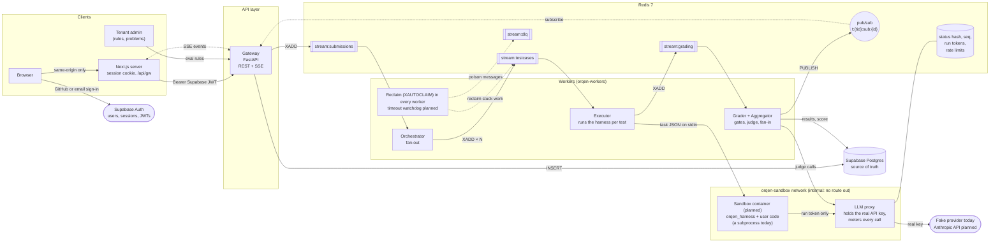

The **executor scales horizontally**: adding executors increases throughput until the provider quota, enforced in the proxy, becomes the limit.

---

## 3. Submission lifecycle

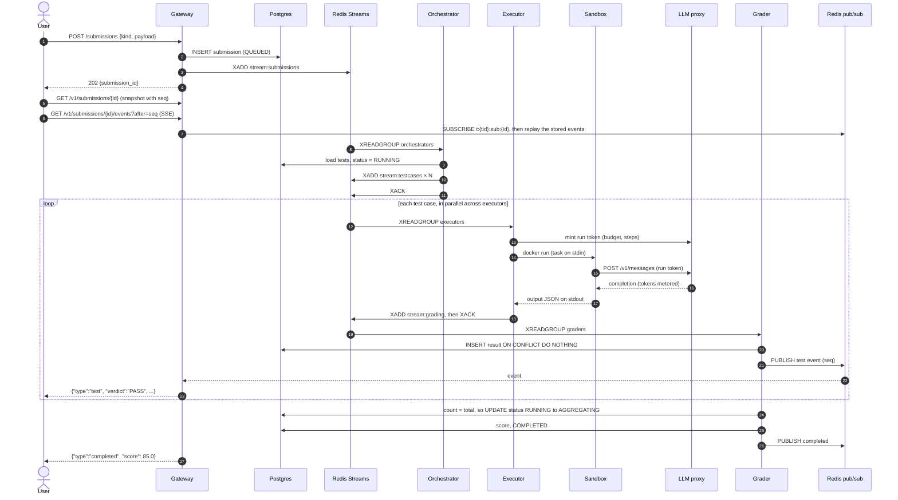

A worker acks a message (`XACK`) only after its output is durable: either the next `XADD` succeeded or the Postgres row is committed.

---

## 4. Submission states

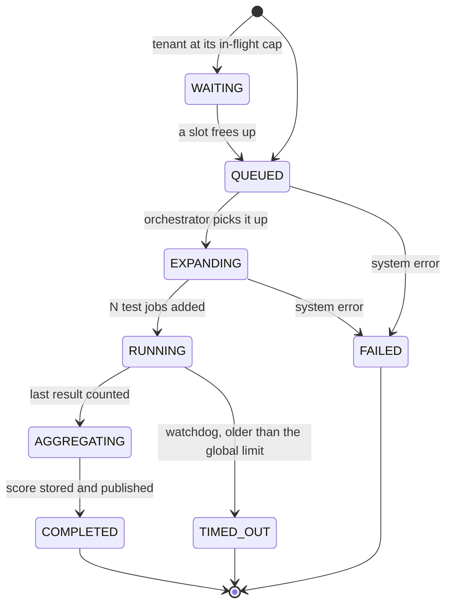

Verdicts for each test case:

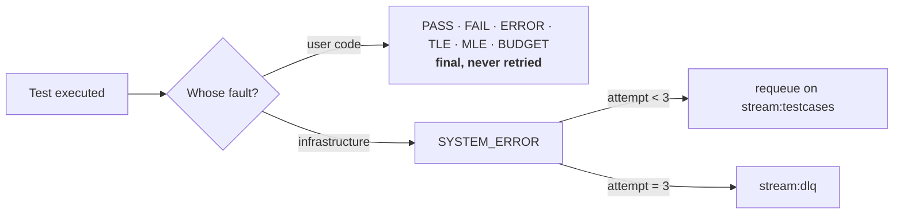

---

## 5. Fan-in: who computes the score

Results arrive in any order, and some arrive more than once. Exactly one grader must aggregate. Postgres makes that decision, and the Redis counter only shows progress. [Postgres decides when a submission is complete](#postgres-decides-when-a-submission-is-complete) explains why.

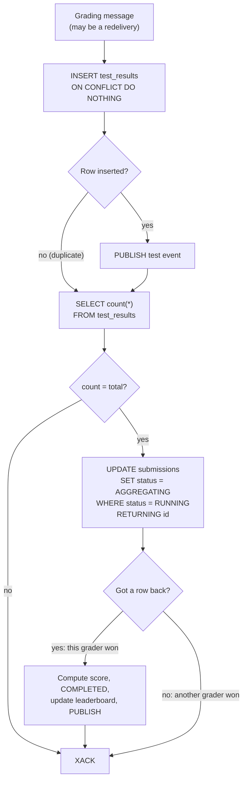

Because the count runs on every delivery, a redelivery after a crash still completes the submission.

The insert commits before the count runs, in its own transaction. If two graders inserted the last two results in one transaction each and counted inside it, each would miss the other's uncommitted row and neither would aggregate. Committing first means whichever grader commits last sees every row.

A test's score is the share of the eval rule's gates that pass, from 0 to 1. The submission's score is the test scores averaged by `test_cases.weight` and scaled to 0 to 100. A `submit` outside a contest also updates `competition.practice_bests` when it beats the user's best.

---

## 6. Trust boundaries

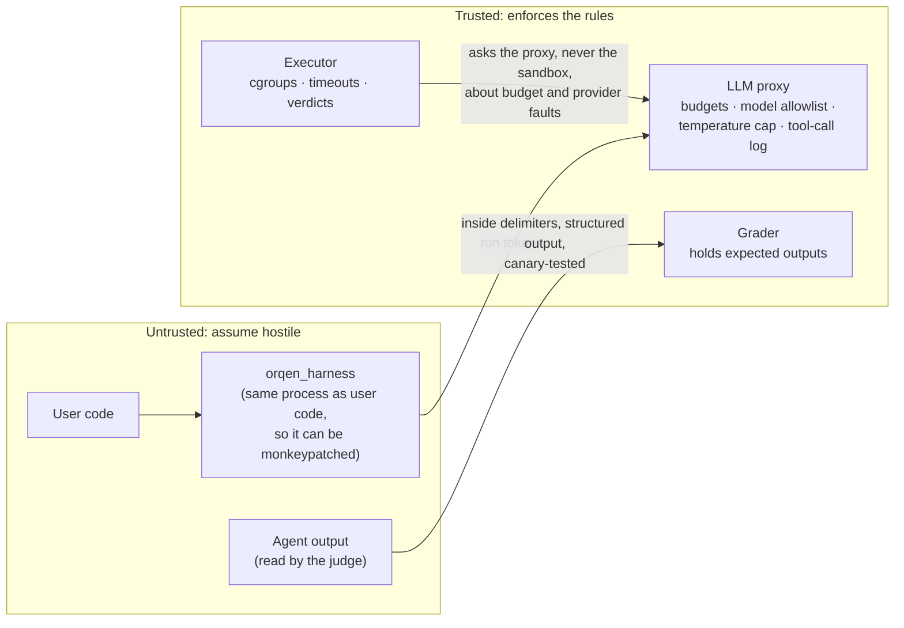

Rules that follow from this:

- **The real provider key never enters a sandbox.** In the sandbox, `ANTHROPIC_API_KEY` is a single-use run token and `ANTHROPIC_BASE_URL` points at the proxy.
- **Expected outputs never enter a sandbox.**
- **Hidden tests return only verdicts and scores.** Users never see stdout, traces or judge reasons for hidden tests, because any of them could quote the hidden input.
- **Trajectory grading uses the proxy's log of tool calls.** Anything the sandbox reports about itself can be faked.

---

## 7. Data model

Built by migrations `0001` to `0006`. Tables are grouped into one Postgres schema per feature, and code always names a table with its schema, such as `judging.submissions`. Only `alembic_version` stays in `public`.

| Schema | Tables | Holds |
|---|---|---|
| `identity` | `tenants`, `users`, `memberships` | Who someone is and their role: `admin`, `setter` or `contestant` |
| `authoring` | `problems`, `problem_authors`, `eval_rules`, `calibration_examples`, `test_cases` | What setters write |
| `judging` | `submissions`, `test_results` | What contestants send and how it scored |
| `competition` | `contests`, `contest_problems`, `contest_standings`, `practice_bests` | Contests and both leaderboards |
| `billing` | `plans`, `subscriptions`, `usage_periods`, `model_prices`, `paddle_events` | Plans, credit and Paddle webhooks |
| `ops` | `llm_usage`, `audit_log` | Append-only records |

Every table owned by a tenant has a `tenant_id`, and each child table references its parent by `(tenant_id, id)`. That composite foreign key makes it impossible to point at another tenant's row. Orqen runs as one platform in a single tenant today, and the tenant columns let organisations be added later without a schema rewrite. `billing.plans`, `billing.model_prices` and `billing.paddle_events` are platform-wide and have no `tenant_id`.

The roles nest: an admin can do everything a setter can, and a setter everything a contestant can.

### Authoring and judging

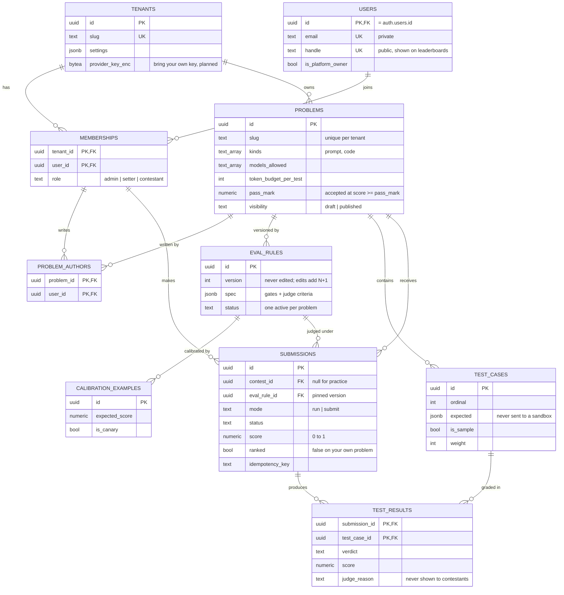

The primary key of `TEST_RESULTS` is what removes duplicates during fan-in. A submission to a problem in `PROBLEM_AUTHORS` for the same user is stored with `ranked = false` and never reaches a leaderboard.

### Competition and billing

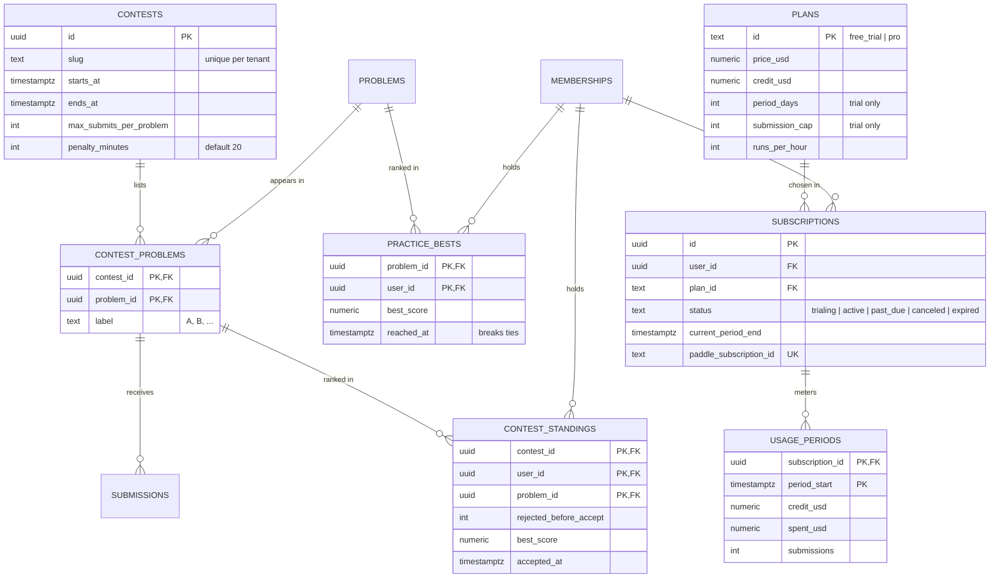

Contests rank ICPC-style: most problems accepted first, then the lowest penalty. A problem's penalty is the minutes from `starts_at` to `accepted_at`, plus `penalty_minutes` for each rejected submit before it. A user has at most one live subscription, and one free trial ever; two partial unique indexes on `SUBSCRIPTIONS` enforce both. `PADDLE_EVENTS` is keyed by Paddle's event id, so a redelivered webhook inserts nothing. `MODEL_PRICES` holds the per-model token prices the proxy uses to turn tokens into dollars.

### Database roles and row-level security

Migration `0004` turns on row-level security for every table. Services connect as the table owner and switch to one of four roles for each transaction. None of them owns a table, so the policies apply to all of them.

| Role | Acts for | Can |
|---|---|---|
| `orqen_contestant` | A signed-in user | Read listed problems and their sample tests, submit as themselves, read their own submissions and results, read leaderboards |
| `orqen_setter` | A setter | Everything a contestant can, plus write problems, tests and eval rules for problems they author |
| `orqen_admin` | An admin | Everything a setter can, plus read and manage everything in the tenant |
| `orqen_worker` | Orchestrator, executors, grader, proxy, webhooks | Read the tenant's problems and hidden tests, write results, standings and usage |

The human roles nest through role membership, so a policy written for `orqen_contestant` also covers setters and admins. Policies read the tenant and user from `app.tenant_id` and `app.user_id`. Some rules can't be expressed as row filters, so grants and triggers enforce them:

- A contestant inserts a submission through a column grant that leaves out `score`, `status`, `ranked` and `eval_rule_id`. A trigger pins the active eval rule and sets `ranked = false` when the submitter authored the problem.
- A contestant can read the verdict and score of every test in their submission, but `output`, `judge_reason` and the other detail columns aren't granted. `judging.sample_test_outputs` returns those columns for sample tests only.
- A problem in a contest that hasn't started is hidden. While a contest runs, its problems take contest submissions only. After it ends, every contest submission becomes readable, and the problems return to the practice archive.
- No role can update or delete `ops.llm_usage`.
- Contestants see the `handle` of every user in their tenant, never the email, and can change only their own handle. A trigger derives a handle from the email when none is given.
- A trigger enforces each contestant's plan before a submission is stored: a live subscription (SQLSTATE `OQ402`), the trial's submission cap (`OQ402`), `runs_per_hour` sample runs in a rolling hour (`OQ429`), and a contest's `max_submits_per_problem` (`OQ429`). Admins and setters are exempt. A per-user advisory lock stops concurrent submits from both passing a count.

---

## 8. Code structure

### Package dependencies

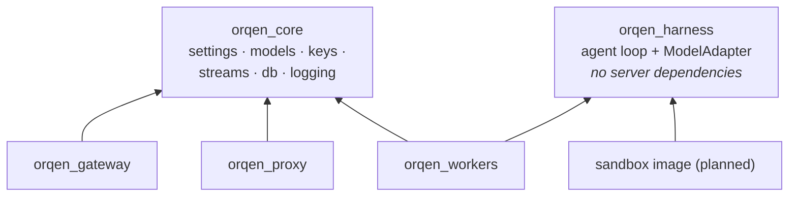

`orqen_harness` deliberately depends on nothing server-side (only `pydantic` and `httpx`), so the sandbox image installs it without Postgres drivers, Redis clients or secrets. The workers import it only for the `Task` and `Result` types they exchange with it.

### Core types (UML)

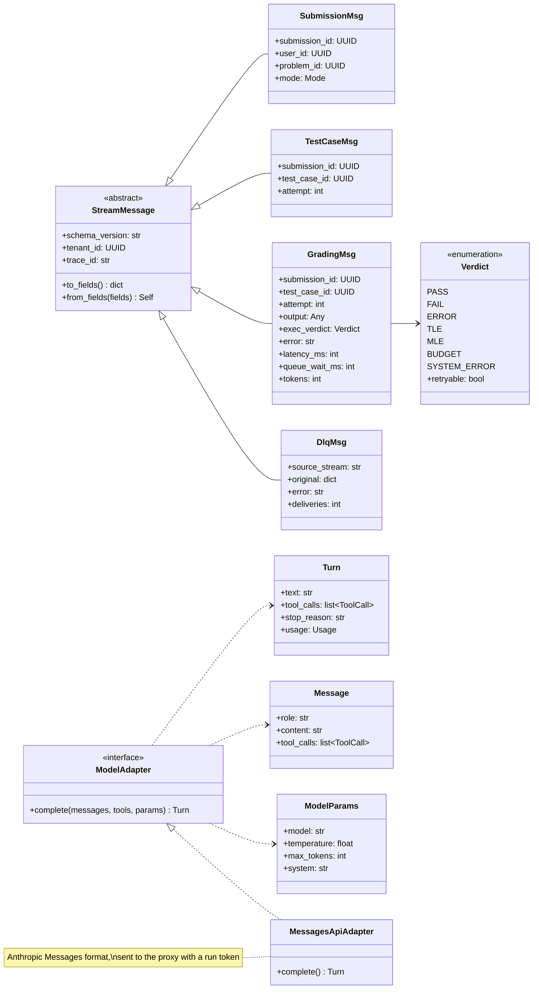

### Gateway API

Every route except `/v1/public/*` needs a Supabase access token in `Authorization: Bearer`. The gateway checks it against the project's public keys (see [Supabase hosts Postgres and Auth](#supabase-hosts-postgres-and-auth)), then runs its queries as the caller's database role.

| Route | Does | Responses |
|---|---|---|
| `GET /v1/me` | The caller's handle, role, plan and subscription status | `200`; `403` before `POST /v1/me` |
| `POST /v1/me` | Creates the caller's `identity.users` row, a `contestant` membership in the platform tenant and a free trial, each only if missing. Call it after every sign-in | `200` with handle, role, plan and subscription status |
| `POST /v1/submissions` | Inserts the submission and adds it to `stream:submissions`, or to `stream:submissions:priority` for `mode: run`. An `Idempotency-Key` header makes retries return the first submission | `202`; `200` for a repeated key; `402` and `429` for plan limits; `403` before `/v1/me`; `404` for a problem that isn't open |
| `GET /v1/problems` | Listed problems with limits, the caller's best and how many solved each | `200` |
| `GET /v1/problems/{id}` | Statement, limits, `pass_mark` and the sample tests (hidden tests never) | `200`, `404` |
| `GET /v1/problems/{id}/leaderboard` | Practice leaderboard by handle, best score first | `200` |
| `GET /v1/submissions` | The caller's recent submissions, newest first | `200` |
| `GET /v1/submissions/{id}` | Snapshot for the live view: status, score, `seq` and every event so far. After the event list expires, events are rebuilt from `test_results` | `200`, `404` |
| `GET /v1/public/arena` | No token. Listed problems with solve counts, the top 10 handles by summed best score, and the number of ranked agents. Runs as `orqen_contestant` for a user who doesn't exist, so row-level security limits it to what any contestant sees; emails are never selected. Cached in-process for 30 seconds | `200` |
| `GET /v1/submissions/{id}/events?after=seq` | `text/event-stream`. Subscribes first, replays stored events above `after` (or `Last-Event-ID`), then follows live ones; ends after `completed` or 10 minutes | `200`, `404` |

Every event passes `orqen_gateway.live.public_event`, an allow-list per event type (`meta`, `status`, `test`, `completed`). It is the redaction contract: outputs, expected values and traces never reach a browser, whatever a worker publishes. Test events carry the test number, `sample` or `hidden`, attempt, verdict, score, tokens, steps, latency and a judge-authored detail. A `SYSTEM_ERROR` retry is its own event, so the log shows one row per attempt.

Body of `POST /v1/submissions`:

```json
{"problem_id": "uuid", "mode": "submit", "kind": "prompt", "prompt": "...", "model": "claude-haiku-4-5", "contest_id": null}
```

`kind` accepts only `prompt` until the sandbox exists. `model` falls back to the first of the problem's `models_allowed`.

### Executor and harness

For each test job the executor mints a run token in Redis (`run:{token}`: tenant, user, submission, test, allowed models, token budget), then starts `python -m orqen_harness` with a bare environment and writes one `Task` to its stdin:

```json
{"proxy_url": "http://proxy:8080", "run_token": "orq_run_...", "model": "claude-haiku-4-5",
 "system": "<the contestant's prompt>", "input": {"text": "..."}, "max_steps": 6}
```

The harness runs the agent loop against the proxy and prints one `Result`: `status`, the parsed `output`, `steps`, token `usage` and `error`. The executor turns it into a verdict:

| Harness outcome | Verdict |
|---|---|
| `ok` | Graded by the eval rule: `PASS` or `FAIL` |
| Past the problem's `time_limit_ms` | `TLE` |
| `budget`: the proxy refused for budget | `BUDGET` |
| `max_steps` or `rejected` | `ERROR` |
| `provider_error`, a crash or unreadable output | `SYSTEM_ERROR`, retried as a new job up to 3 attempts |

The token is revoked when the run ends and expires 60 seconds after the time limit in any case.

### LLM proxy

`POST /v1/messages` takes the Anthropic Messages format with the run token as `x-api-key`. It refuses an unknown token (`401`), a model outside the allowlist (`400`) and a spent budget (`402`), and caps `max_tokens` at what is left. After each call it adds the tokens to the run's spend and writes an `ops.llm_usage` row priced from `billing.model_prices`.

`ORQEN_PROVIDER` picks the backend. Only `fake` exists today. It answers each test with that test's expected output, so a normal submission scores 100, and it reads markers in the contestant's prompt:

| Marker | Effect |
|---|---|
| `#fake:wrong` | Every field of the answer is wrong |
| `#fake:slow=1.5` | Waits 1.5 seconds before answering |
| `#fake:error` | Fails with `500`, as a provider outage would |

Token counts are estimated at four characters per token, so cost reporting works with the fake too.

### Repository layout

| Path | What it is |
|---|---|
| `packages/core` | `orqen_core`: settings, domain enums, stream payloads, the Redis keyspace, DB helpers, logging |
| `packages/harness` | `orqen_harness`: the agent loop and model adapters |
| `services/gateway` | Auth, problems, submissions, the live event stream |
| `services/proxy` | The LLM proxy: holds the real provider keys, meters and limits every call |
| `services/workers` | One `orqen-workers` command for the orchestrator, executor, grader and watchdog |
| `sandbox/` | The sandbox image (planned) |
| `web/` | The Next.js frontend; see [Frontend](#13-frontend) |
| `migrations/` | Alembic migrations, written by hand. Autogenerate is not used |
| `scripts/seed.py` | Dev seed that is safe to rerun |

---

## 9. Redis keyspace and streams

| Stream | Consumer group | Payload |
|---|---|---|
| `stream:submissions` | `orchestrators` | `SubmissionMsg` |
| `stream:submissions:priority` | `orchestrators` | `SubmissionMsg` ("Run on samples" lane) |
| `stream:testcases` | `executors` | `TestCaseMsg` |
| `stream:grading` | `graders` | `GradingMsg` |
| `stream:dlq` | `operators` | `DlqMsg` |

| Key | Type | Purpose |
|---|---|---|
| `t:{tid}:sub:{id}:status` | hash | Snapshot sent to a client when it connects or reconnects |
| `t:{tid}:sub:{id}:seq` | int | Sequence number for events, so clients can drop duplicates |
| `t:{tid}:sub:{id}` | pub/sub | Live events for one submission |
| `t:{tid}:sub:{id}:remaining` | int | Progress display only |
| `t:{tid}:inflight` | int | Per-tenant admission cap |
| `t:{tid}:lb:{problem_id}` | zset | Leaderboard |
| `run:{token}` | hash | Per-run credential and budget, read by the proxy |
| `t:{tid}:sub:{id}:events` | list | Every event of one submission, replayed by the snapshot and by reconnecting streams |

The snapshot race is handled in this order: subscribe first, then read the stored events (including `seq`), then forward only live events with a higher `seq`. Two workers can append events out of order, so readers sort by `seq`.

---

## 10. Set up and run

You need Docker, [uv](https://docs.astral.sh/uv/), Python 3.12 (uv downloads it if it's missing) and a Supabase project. Docker runs only Redis and the throwaway test database. The application database and user accounts live in Supabase.

### Run locally

1. Copy `.env.example` to `.env` and replace the `<...>` placeholders with your Supabase project's session pooler URL, project URL and secret key (`sb_secret_...`). Leave `ORQEN_MIGRATION_DATABASE_URL` commented out unless your network has IPv6.
2. Apply the schema and seed the `orqen` tenant, its owner and two contestants:

   ```sh
   make install
   make migrate          # alembic upgrade head on Supabase
   make seed             # safe to rerun
   ```

3. Start the services:

   ```sh
   make up           # Redis on localhost:6380
   make streams      # create the Redis streams and consumer groups
   make gateway      # http://localhost:8000/readyz checks Supabase and Redis
   make proxy        # the LLM proxy on :8080, with the fake provider
   make workers      # orchestrator, executor and grader in one process
   ```

4. Sign in through Supabase (GitHub, or an email and password), then call `POST /v1/me` and `POST /v1/submissions` with the access token. `GET /v1/submissions/{id}` shows the result.

`make help` lists every target.

### Run the tests

```sh
make up test-db   # Redis, plus Postgres on localhost:5433
make check        # ruff, mypy and pytest: the same checks CI runs
```

The integration tests drop and rebuild their database on every run. `tests/conftest.py` refuses any database whose name doesn't end in `_test` or whose URL contains `supabase`, so a misconfigured `.env` can't wipe Supabase. Before migrating, the tests add the Supabase objects that migration `0002` reacts to: the `anon` and `authenticated` roles and an `auth.users` table.

---

## 11. Conventions

- **Redis keys and stream names** come only from `orqen_core.keys` and `orqen_core.streams`.
- **Stream payloads** are `StreamMessage` subclasses, stored as `{v, data}`. Bump `schema_version` when a payload changes shape.
- **Enums and SQL CHECK constraints** are defined in both places. `tests/unit/test_models.py` fails if they drift apart.
- **Every query from a request or a job** runs inside `orqen_core.db.tenant_tx`, which switches to the caller's database role and sets `app.tenant_id` and `app.user_id` for that transaction only.
- **Logs** are JSON lines. `trace_id` arrives in the `X-Trace-ID` header and travels in every stream payload.
- **Migrations** are hand-written SQL. Never autogenerate them: autogenerate would silently drop the CHECK constraints, partial indexes and RLS policies.

---

## 12. Design decisions

### Redis Streams carry the work, pub/sub carries live events

A test job must survive a worker crash. With Redis lists (`LPUSH` and `BRPOP`), a popped message is gone, so a worker that crashes mid-job loses it. A stream with a consumer group keeps each message in the pending entries list until a worker runs `XACK`. The watchdog can then reclaim the message with `XAUTOCLAIM`, and the delivery count sets the retry limit.

Kafka also gives these guarantees, but it adds partitions, retention settings and a second system to run. Orqen needs Redis anyway for counters, rate limits and pub/sub, so Kafka buys nothing at this scale.

All tenants share one set of streams, and every payload carries `tenant_id`. Per-tenant streams were rejected: each worker would read N streams, and fairness would still need its own logic. A per-tenant admission cap will handle fairness instead.

Delivery is at least once, so every consumer must be idempotent. Redis runs with AOF (`appendfsync everysec`), so a Redis restart doesn't drop unacknowledged entries. Live progress uses pub/sub. Pub/sub can drop messages, which is acceptable because Postgres and the status hash hold the real state.

### Supabase hosts Postgres and Auth

Supabase gives Orqen a managed Postgres, user accounts and JWTs on its free tier, plus `pgvector` for later. Orqen uses only those parts. It doesn't use the Data API, Supabase's migration tool or row-level security through Supabase roles.

- **Auth:** Supabase Auth owns sign-up, passwords, GitHub sign-in and sessions. `users.id` equals `auth.users.id`, and a foreign key enforces that, so Orqen never stores a password.
- **Tokens:** Supabase signs access tokens with an asymmetric key. The gateway fetches the public keys from `/auth/v1/.well-known/jwks.json`, caches them for 10 minutes and fetches again when a token names an unknown key, at most every 30 seconds. It checks the signature, `exp`, `aud = authenticated` and the issuer, and uses `sub` as the user id. It refuses `HS256`, so the legacy shared secret can't sign a token the gateway accepts.
- **Data API off:** on Supabase, new tables in `public` are granted to the `anon` and `authenticated` roles, which anyone with the project's publishable key can use. Migration `0002` revokes those grants and stops future tables from receiving them.
- **Two connections:** the app uses the session pooler, which works on IPv4 and keeps session state. Migrations use the direct connection, as Supabase recommends.
- **Tests stay local:** the integration tests rebuild their database on every run, so they run against a disposable Postgres container, never against Supabase.

### Orqen runs its own agent loop

`orqen_harness` contains the agent loop. The loop calls the model, runs the tool calls the model asks for, and repeats until the model returns a final answer or reaches `max_steps`. The loop talks to the model only through the `ModelAdapter` protocol, and Claude is the first adapter. The LLM judge uses the same adapter for a single call with structured output.

The original plan used Google ADK. ADK's runner, sessions and evaluator are built for one developer testing one agent. Orqen needs a small loop that it can audit, that works with any provider, and that is metered at the proxy. ADK meters through callbacks that run in the same process as user code, and user code can monkeypatch them.

Because the loop runs inside the sandbox, Orqen treats the harness as untrusted too. The proxy enforces the budgets, the model allowlist and the temperature cap, and it records every tool call. To add a provider, write an adapter and a matching translation in the proxy.

### Postgres decides when a submission is complete

N test results reach the graders in any order, and some arrive more than once. Exactly one grader must compute the final score.

The obvious designs write to two systems in a row: `HSETNX` and then `HINCRBY`, or `INSERT` and then `DECR`. If a grader crashes between the two writes, the counter never reaches zero. Redelivery doesn't fix it, because the first write already happened and the grader skips the second.

Orqen counts in Postgres instead, on every delivery, including duplicates:

```sql
INSERT INTO test_results ... ON CONFLICT (submission_id, test_case_id) DO NOTHING;
SELECT count(*) FROM test_results WHERE submission_id = $1;
-- If the count equals the total, try to claim aggregation.
-- Only the grader that gets a row back computes the score:
UPDATE submissions SET status = 'AGGREGATING'
 WHERE id = $1 AND status = 'RUNNING'
RETURNING id;
```

A redelivery after a crash runs the count again and completes the submission. The conditional `UPDATE` lets exactly one grader win. Each result costs one extra `count(*)`, which the primary key index serves. Completion no longer depends on Redis agreeing with Postgres.

---

## 13. Frontend

`web/` is a Next.js 16 app (App Router, TypeScript, CSS modules). It follows the reference design: a dark terminal UI in JetBrains Mono, square 1px-ruled layouts, colour used only for meaning, and every verdict printed with its label.

### Screens

| Route | Screen | Data |
|---|---|---|
| `/` | Public landing page: a replaying judge log, the five stages, the seven verdicts, live problems and leaderboard, pricing and FAQ | `GET /v1/public/arena`, streamed in |
| `/login` | GitHub sign-in; email sign-in, sign-up and password reset | Supabase Auth |
| `/reset-password` | Set a new password after the reset email | Supabase Auth |
| `/problems` | Problem set: limits, your best, solved count | `GET /v1/problems` |
| `/p/:id/submit` | Statement, limits grid, samples, practice leaderboard; prompt editor with Run samples and Submit | `GET /v1/problems/{id}`, `POST /v1/submissions` |
| `/s/:id` | Live judging: pipeline breadcrumb, one log row per event, redacted hidden traces, final summary, vim-style status bar | Snapshot + SSE |
| `/submissions` | Your submissions; sample runs are drawn dashed so they never read as ranked submits | `GET /v1/submissions` |
| `/c/:id/standings` | Contest scoreboard | Sample data until a standings API exists |
| `/admin/rules/:id` | Eval-rule editor with calibration gating, admins only | Sample data until M6 |
| `/dev/workbench` | Every component with a fixture for each verdict and stage | Development builds only |

Keys `1`–`4` switch tabs, `e` expands every log row, `r` replays a finished log, and `ctrl+⏎` submits. Shortcuts are ignored while typing in a field.

### Security model

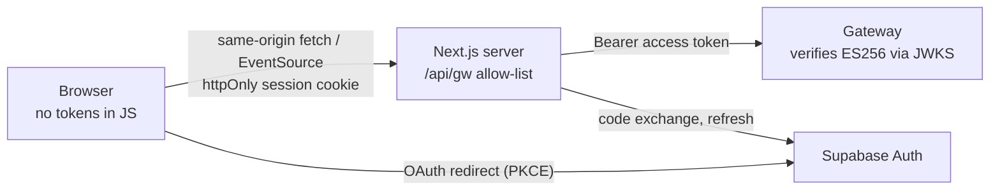

- **Tokens never reach browser JavaScript.** Supabase session cookies are `httpOnly`, `SameSite=Lax` and `Secure` in production. OAuth starts on the server (`/auth/login`), so the PKCE code verifier is an httpOnly cookie too, and the callback exchanges the code server-side. Email sign-in, sign-up and password reset are plain form posts to `/auth/password`, which refuses any other `Origin`. Email links land on `/auth/confirm`, which verifies the token server-side. Error messages never say whether an email is registered.
- **The browser talks only to its own origin.** `/api/gw/*` forwards to the gateway with the user's access token. It passes only allow-listed method and path pairs and query keys, refuses mutations whose `Origin` isn't the site, requires `application/json`, and caps bodies at 64 kB. The gateway isn't exposed to browsers, so it needs no CORS.
- **Every layer verifies.** `src/proxy.ts` refreshes the session and redirects signed-out visitors, but it's a convenience: server pages verify the session with `getClaims()` (signature checked against the JWKS), and the gateway verifies the token again and refuses `HS256`.
- **Content-Security-Policy with a per-request nonce:** scripts run only with the nonce, `connect-src` and `form-action` are `'self'`, `frame-ancestors 'none'`. Fonts are self-hosted at build time. Other headers: HSTS (production), `X-Frame-Options: DENY`, `nosniff`, a strict referrer policy and a locked-down `Permissions-Policy`.
- **No HTML injection:** problem statements render through a small parser that builds React nodes; nothing uses `dangerouslySetInnerHTML`.
- **Server-only code** (`src/lib/server/*`) imports `server-only`, and there are no `NEXT_PUBLIC_` variables. The web app uses the Supabase *publishable* key and refuses a secret key.
- **Post-login redirects** accept only same-site paths (`safeNext`).

### Live judging in the client

`useSubmissionStream` loads the snapshot, then opens an `EventSource` from its `seq`. Events are buffered and applied once per animation frame by a pure reducer that drops duplicates, never moves a stage backwards, and refetches the snapshot on a gap in `seq`. The log follows new rows while you're within 40px of the bottom; scrolling up or expanding a row releases it, and a "↓ n new" button brings it back. Rows use `content-visibility: auto`, so long logs stay cheap.

### Motion

Rows slide in as events land, verdicts settle into place, the pipeline breadcrumb and status bar change colour as stages advance, the final score counts up, scoreboard rows animate to their new rank (FLIP), new accepts flash, sections fade in as they scroll into view, and the statement pane shows a reading-progress line. Every duration is a token and collapses to zero under `prefers-reduced-motion`.

### Landing page

`src/features/landing/` builds `/` from one section component per block, each with its own CSS module. Sections are server components; their effects come from data attributes that `motion.ts` wires up in one client wrapper:

| Attribute | Effect |
|---|---|
| `data-pin` | Sets `--p` from 0 to 1 while the section scrolls past its sticky stage. The hero fades its copy into a single log line, and the problems track slides sideways |
| `data-stages` | Marks the current stage in the "five stages" section, so scrolling steps through them |
| `data-reveal` | Adds `data-in` the first time the element enters the viewport; CSS fades or lifts it, staggered by `--d` |
| `data-spot` | Tracks the pointer in `--mx` and `--my` for spotlight gradients |
| `data-magnet`, `data-scramble` | Buttons lean towards the pointer; nav links scramble their text on hover |
| `data-type` | Types a command once it is visible |
| `data-skew`, `data-view` | Scroll velocity skews the problems track; the footer wordmark rises as it enters |

The hero's log is `replay.ts`: a seeded generator of judge lines, so the server and the browser render the same first rows. It pauses when off screen or in a background tab. Under `prefers-reduced-motion`, only scroll-driven pins remain and everything else shows its final state. Pointer effects are off on touch screens.

Background textures live in `web/public/bg/` (`grid`, `dots`, `contours`, `scanlines`, `noise`). They were generated for Orqen, so they carry no licence terms. To use another texture, add a file there and pass its path to `<Backdrop src="/bg/<file>" />`; `size`, `opacity`, `fade` and `parallax` tune it.

### Run it

```sh
cd web
cp .env.example .env.local   # SITE_URL, SUPABASE_URL, SUPABASE_PUBLISHABLE_KEY, ORQEN_GATEWAY_URL
npm install
npm run dev                  # http://orqen.localhost:3000, with make gateway proxy workers running
npm run lint && npm run typecheck && npm test && npm run build
npm run types                # regenerate src/lib/api/schema.d.ts from openapi.json
```

In Supabase, add `http://orqen.localhost:3000/auth/callback` and `http://orqen.localhost:3000/auth/confirm` (and the production equivalents) to **Authentication > URL Configuration > Redirect URLs**.
