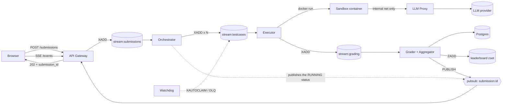

# Orqen — Product Requirements Document

**Version:** 0.1 (draft) · **Date:** 28 Oct 2026 · **Status:** In development

---

## 1. Overview

Orqen is an online judge for AI agents, modelled on Codeforces and LeetCode. A user picks a problem (for example, "extract invoice fields from messy text" or "answer multi-step arithmetic questions using a calculator tool") and submits an **agent**: a small Python program plus a config that uses an LLM to solve the task. The platform runs that agent against a hidden test suite inside isolated sandboxes, grades every test case, and shows a verdict, a score, and a leaderboard rank.

The browser never talks to the execution layer directly. The API gateway accepts the submission, returns an ID immediately, and pushes the work onto Redis Streams. Workers expand, execute, grade, and aggregate the job, and status updates flow back to the browser in real time over Redis pub/sub and Server-Sent Events (SSE).

**Why build it:** The project exists to learn distributed-systems fundamentals hands-on. These are async job queues, fan-out/fan-in, consumer groups, at-least-once delivery, idempotency, sandboxing of untrusted code, rate limiting against a third-party API, and real-time result delivery. The product has to be genuinely usable, but every design choice should also make one of those concepts concrete.

---

## 2. Goals and non-goals

### Goals (v1)

1. A user can submit an agent and see a verdict for each test case, streamed live, within about 2 minutes for a 20-case problem.
2. Untrusted user code can never reach the internet, the host, other submissions, or the hidden expected outputs.
3. LLM usage is metered per submission and per user, with hard budgets and rate limits enforced centrally.
4. The system survives a worker crash mid-job. The job is redelivered and finishes with no duplicate results and no lost submissions.
5. Executors scale horizontally: adding workers increases throughput with no code changes.

### Non-goals (v1)

- Multi-language agents. Python only.
- Contests with timed rounds, ratings, or plagiarism detection. These are possible later.
- Agents that browse the open web. Agents only get the tools the problem provides.
- Production-grade multi-tenant isolation (gVisor/Firecracker). Docker with strict limits is enough for v1, and stronger isolation is listed as a stretch goal.
- Billing or payments.

---

## 3. Users and personas

| Persona | Description | Primary needs |
|---|---|---|
| **Agent builder** | A developer experimenting with prompts and tool use who wants to know objectively whether their agent is good | Fast feedback, clear per-test verdicts, visible token cost, leaderboard |
| **Problem setter (admin)** | Creates problems, writes test cases and grading rules | Simple problem authoring, choice of grading mode, ability to rejudge |
| **Operator (you)** | Runs the infrastructure | Queue visibility, failure alerts, cost control, ability to replay dead-lettered jobs |

---

## 4. Core user flows

### 4.1 Submit and watch

1. The user opens a problem page and reads the statement, the sample cases, the available tools, and the budget (for example, max 20k tokens per test).
2. The user uploads `agent.py` (and optionally `agent.yaml`), or pastes the code into an editor.
3. The user clicks **Submit**. The gateway validates the submission and responds `202 Accepted` with a `submission_id`.
4. The browser opens an SSE stream and watches the status move through the stages: `Queued → Running 3/20 → Grading → Completed`.
5. Each test case row fills in live with its verdict (PASS, FAIL, ERROR, TLE, MLE, BUDGET), its latency, and its token count.
6. The final screen shows the score, total tokens, estimated cost, and the user's new leaderboard rank.

### 4.2 Run on samples (fast path)

The user clicks **Run** instead of **Submit**. Only the public sample cases are executed, the result doesn't count toward the leaderboard, and the job goes to a higher-priority queue so iteration feels quick.

### 4.3 View history and leaderboard

The user can list past submissions with their verdicts and open any of them to see per-test details. Hidden test inputs are never shown; only the verdict and a short error message are. The leaderboard ranks users by best score per problem.

### 4.4 Admin: create problem and rejudge

The admin creates a problem with a statement, tool definitions, a grading mode, test cases (marked sample or hidden), and budgets. If a test case changes, the admin can trigger a **rejudge**, which re-enqueues all accepted submissions for that problem.

---

## 5. Functional requirements

**P0** = must-have for v1 · **P1** = should-have · **P2** = stretch

| ID | Requirement | Priority |
|---|---|---|
| F1 | User signup/login (email + password or GitHub OAuth) with JWT sessions | P0 |
| F2 | List problems and view a problem statement with sample cases and tool specs | P0 |
| F3 | Submit agent code. The gateway validates size (≤ 64 KB), syntax (`ast.parse`), and that `solve` is defined | P0 |
| F4 | Asynchronous judging via Redis Streams. The submit endpoint returns in < 200 ms regardless of load | P0 |
| F5 | Fan-out of a submission into one job per test case, and fan-in when all are done | P0 |
| F6 | Sandboxed execution of user code with CPU, memory, time, and network limits | P0 |
| F7 | All LLM calls routed through the internal LLM proxy, which enforces auth, budget, and rate limits | P0 |
| F8 | Grading modes: `exact`, `normalized`, `json_fields`, `numeric_tolerance`, `llm_judge` | P0 (first four), P1 (`llm_judge`) |
| F9 | Live status via SSE, backed by Redis pub/sub | P0 |
| F10 | Submission history and per-test verdict details | P0 |
| F11 | Per-problem leaderboard in a Redis sorted set | P1 |
| F12 | "Run on samples" priority lane | P1 |
| F13 | Admin problem authoring UI and rejudge | P1 |
| F14 | Dead-letter queue viewer with a replay button for the operator | P1 |
| F15 | Cache of identical (prompt, params) LLM calls to cut cost | P2 |
| F16 | gVisor (`runsc`) runtime for stronger isolation | P2 |
| F17 | Paid/priority tier queue | P2 |

### 5.1 Agent contract

Every submission must define this entry point:

```python
# agent.py
def solve(task: dict, llm, tools) -> dict:
    """
    task  : the test case input (problem-specific JSON)
    llm   : client provided by the harness; llm.chat(messages, **params) -> str
    tools : object exposing the problem's tools, e.g. tools.calculator("2*3")
    return: JSON-serialisable answer, graded against the expected output
    """
```

Optional `agent.yaml`:

```yaml
model: default          # resolved by the proxy to an allowed model
temperature: 0.2
max_steps: 8            # cap on LLM calls per test case
```

The harness, not the user, owns the `llm` and `tools` objects. That is what lets the platform meter, limit, and log every call.

### 5.2 Verdicts

| Verdict | Meaning | Retried by the system? |
|---|---|---|
| `PASS` | Output matched under the problem's grading mode | — |
| `FAIL` | Output did not match | No |
| `ERROR` | User code raised an exception or returned non-JSON | No |
| `TLE` | Exceeded the per-test wall-clock limit | No |
| `MLE` | Container killed for exceeding the memory limit | No |
| `BUDGET` | Exceeded the token budget or `max_steps` | No |
| `SYSTEM_ERROR` | Infrastructure failure (provider down, worker crash) | **Yes**, up to 3 times, then DLQ |

The rule behind the last column: **user faults are final, infrastructure faults are retried.** Getting this distinction right is a core learning goal.

### 5.3 Scoring

- Score = (passed hidden tests ÷ total hidden tests) × 100, with optional per-test weights.
- Tie-break 1: fewer total tokens wins. This rewards efficient agents, not just correct ones.
- Tie-break 2: earlier submission time wins.

---

## 6. System architecture

### 6.1 Components

| Service | Responsibility | Scales |
|---|---|---|
| **Web client** | Problem pages, editor, live verdict table, leaderboard | CDN/static |
| **API gateway** (FastAPI) | Auth, validation, writes submissions to Postgres, `XADD` to `stream:submissions`, serves SSE by subscribing to Redis pub/sub | Horizontally, stateless |
| **Orchestrator worker** | Consumes submissions, loads the test list, initialises fan-in counters, fans out one job per test case | 1–2 instances |
| **Executor worker** | Consumes test-case jobs, launches a sandbox container, captures output, resource usage, and verdicts like TLE/MLE | Horizontally, the main scaling knob |
| **LLM proxy** | The only route from sandboxes to model providers. Authenticates the per-run token, enforces budgets and rate limits, records usage, retries provider 429s | 1–3 instances |
| **Grader worker** | Compares output to expected using the problem's grading mode, writes the result, triggers fan-in | Horizontally |
| **Aggregator** (inside grader or separate) | When the counter reaches zero, computes the final score, updates the leaderboard, publishes completion | Same as grader |
| **Watchdog** | Periodically reclaims stuck messages (`XAUTOCLAIM`), moves poison messages to the DLQ, times out stale submissions | 1 instance |
| **Postgres** | Source of truth: users, problems, submissions, results, usage | — |
| **Redis 7** | Streams (work queues), pub/sub (live updates), counters, rate limits, leaderboard, cache | — |
| **MinIO / S3** | Submission code blobs, large test inputs | — |

### 6.2 Diagram



### 6.3 Queues and channels

| Name | Type | Producer → consumer group | Payload |
|---|---|---|---|
| `stream:submissions` | Stream | Gateway → `orchestrators` | `submission_id, user_id, problem_id, mode(run/submit)` |
| `stream:submissions:priority` | Stream | Gateway → `orchestrators` | Same; used for "Run on samples" |
| `stream:testcases` | Stream | Orchestrator → `executors` | `submission_id, test_case_id, attempt` |
| `stream:grading` | Stream | Executor → `graders` | `submission_id, test_case_id, output_ref, exec_meta` |
| `stream:dlq` | Stream | Watchdog → operator UI | Original message + error + attempt count |
| `submission:{id}` | Pub/Sub channel | Any worker → gateway SSE | Status / per-test events |

**Why Streams and not plain lists:** With `LPUSH`/`BRPOP`, a message is gone the moment a worker pops it, so a crash loses the job. Streams with consumer groups keep each message in a Pending Entries List until it's `XACK`ed, which gives at-least-once delivery, redelivery after a crash, and a delivery count you can use for retry limits.

**Why pub/sub for status:** Status events are fire-and-forget broadcasts to whichever gateway instance holds the user's SSE connection. If no one is listening, the event is fine to drop, because the source of truth is in Postgres and the client re-fetches the full state when it reconnects.

---

## 7. Job lifecycle

### 7.1 Submission state machine

```
QUEUED ──► EXPANDING ──► RUNNING ──► AGGREGATING ──► COMPLETED
   │            │            │              │
   └────────────┴────────────┴──────────────┴──► FAILED (system) / TIMED_OUT
```

- `QUEUED`: row created, message in `stream:submissions`.
- `EXPANDING`: the orchestrator is loading tests and setting `sub:{id}:remaining = N`.
- `RUNNING`: test-case jobs are in flight. Progress = N − remaining.
- `AGGREGATING`: the last result has arrived and the score is being computed.
- `COMPLETED`: final score stored and published.
- `TIMED_OUT`: the watchdog found the submission older than the global limit (e.g., 10 minutes) with tests still pending.

### 7.2 Test-case lifecycle

`PENDING → EXECUTING → EXECUTED → GRADED(verdict)`, or `→ SYSTEM_ERROR → (retry) → … → DLQ`.

### 7.3 Fan-in mechanism

> **Superseded by [ADR 0003](adr/0003-postgres-is-fan-in-authority.md).** The steps below leave a crash window between the insert and the decrement.

1. The orchestrator sets `sub:{id}:remaining = N` (with a TTL) before fanning out.
2. The grader inserts the result with `INSERT … ON CONFLICT (submission_id, test_case_id) DO NOTHING`.
3. **Only if the insert actually created a row** does the grader run `DECR sub:{id}:remaining`.
4. The grader whose `DECR` returns `0` is the one that runs aggregation, so exactly one worker aggregates.

Step 3 is what makes redelivery safe. A duplicate message hits the unique constraint, inserts nothing, and doesn't decrement the counter twice.

---

## 8. Data model

### 8.1 Postgres

```sql
users        (id, email, password_hash, created_at)
problems     (id, slug, title, statement_md, tools_spec jsonb, grading_mode,
              grading_config jsonb, time_limit_ms, mem_limit_mb,
              token_budget_per_test, max_steps, created_at)
test_cases   (id, problem_id, input jsonb, expected jsonb, is_sample bool,
              weight int default 1)
submissions  (id uuid, user_id, problem_id, mode, code_ref, status,
              score numeric, total_tokens int, cost_usd numeric,
              created_at, completed_at)
test_results (submission_id, test_case_id, verdict, output jsonb,
              latency_ms, tokens int, error_msg text, attempts int,
              PRIMARY KEY (submission_id, test_case_id))
llm_usage    (id, submission_id, test_case_id, model, prompt_tokens,
              completion_tokens, latency_ms, created_at)
```

### 8.2 Redis keys

| Key | Type | Purpose | TTL |
|---|---|---|---|
| `sub:{id}:remaining` | String (int) | Fan-in counter | 1 h |
| `sub:{id}:status` | Hash | Fast status snapshot for reconnecting clients | 1 h |
| `run:{token}` | Hash | Per-run sandbox credentials: `submission_id, test_case_id, tokens_left, steps_left` | Time limit + buffer |
| `rl:user:{uid}` | String/Lua bucket | Submissions per minute per user | 60 s |
| `rl:provider` | Token bucket | Global requests/min to the LLM provider | rolling |
| `lb:{problem_id}` | Sorted set | Leaderboard; composite score encodes score + token tie-break | none |
| `llmcache:{sha256}` | String | Cached LLM response (P2) | 24 h |
| `idem:{key}` | String | Idempotency-Key for `POST /submissions`, preventing double submits on retry | 24 h |

**Leaderboard encoding:** `zscore = score * 1e9 - min(total_tokens, 999_999_999)`. A higher score always wins, and among equal scores, fewer tokens wins.

---

## 9. API contract

### 9.1 REST

| Method | Path | Description |
|---|---|---|
| `POST` | `/auth/signup`, `/auth/login` | Returns a JWT |
| `GET` | `/problems` | List problems |
| `GET` | `/problems/{slug}` | Statement, samples, tool spec, limits |
| `POST` | `/submissions` | Body: `{problem_id, mode: "run"\|"submit", code, config?}`. Header `Idempotency-Key`. Returns `202 {submission_id}` |
| `GET` | `/submissions/{id}` | Full state, including per-test results |
| `GET` | `/submissions/{id}/events` | **SSE** stream of live events |
| `GET` | `/submissions?problem_id=&mine=true` | History |
| `GET` | `/leaderboard/{problem_id}?limit=50` | Top entries plus the caller's rank |
| `POST` | `/admin/problems`, `/admin/problems/{id}/rejudge` | Admin only |
| `GET` / `POST` | `/admin/dlq`, `/admin/dlq/{msg_id}/replay` | Operator only |

### 9.2 SSE events

```
event: status      data: {"status":"RUNNING","done":3,"total":20}
event: test        data: {"test_case_id":7,"verdict":"PASS","latency_ms":1840,"tokens":912}
event: completed   data: {"score":85.0,"total_tokens":18230,"rank":12}
event: error       data: {"message":"System error, retrying"}
```

On connect, the gateway first sends a snapshot from `sub:{id}:status` (or Postgres) and then streams live events. This covers events that were published before the client subscribed, which is the classic pub/sub race.

### 9.3 Internal: LLM proxy

`POST http://llm-proxy:8080/v1/chat` with header `X-Run-Token: <token>`. The proxy resolves the token to a run, checks `steps_left` and `tokens_left`, forwards the request to the provider, decrements both atomically (Lua), logs usage, and returns the completion. Exhausted budget → `402`, which the harness maps to a `BUDGET` verdict.

---

## 10. Sandbox and security

The executor launches one container per test case using the Docker SDK:

| Control | Setting |
|---|---|
| Image | Minimal `python:3.12-slim` plus the harness, pre-pulled; no pip at runtime |
| User | Non-root (`uid 10001`) |
| Filesystem | `--read-only`, writable `tmpfs /tmp` of 16 MB |
| Memory / CPU | `--memory 256m --memory-swap 256m --cpus 0.5` (per problem) |
| Processes | `--pids-limit 64` (stops fork bombs) |
| Privileges | `--cap-drop ALL --security-opt no-new-privileges` |
| Network | Attached **only** to `sandbox-net`, a Docker network with `internal: true` whose only other member is the LLM proxy. No route to the internet, Postgres, or Redis |
| Time | Wall-clock limit enforced by the executor (`container.wait(timeout=…)`, then kill → `TLE`) |
| Output | stdout capped at 64 KB; anything larger is an `ERROR` |
| Inputs | Only the current test's input is passed in, via stdin. Expected outputs never enter the sandbox. They live only in Postgres and the grader |
| Credentials | A short-lived, single-test `run:{token}` scoped to one test case. The real provider API key exists only inside the proxy |

**Threats covered:** reading hidden answers (impossible, because answers are never mounted), exfiltrating data (no internet), burning the platform's LLM budget (per-run token budget), DoS of the host (cgroup limits and PID cap), and attacks on other submissions (one container per test, destroyed afterwards).

**Known gap:** Docker shares the host kernel, so a kernel exploit could escape. gVisor (F16) is the mitigation, and the gap is accepted for v1.

---

## 11. Failure handling

| Failure | Detection | Response |
|---|---|---|
| Executor crashes mid-test | Message stays in the PEL with no `XACK` | Watchdog runs `XAUTOCLAIM` on messages idle > 2× time limit and redelivers them |
| Same message delivered twice | Unique key on `test_results` | Insert is a no-op, no counter decrement (§7.3) |
| Poison message (keeps crashing) | Delivery count from `XPENDING` > 3 | Move to `stream:dlq`, mark the test `SYSTEM_ERROR`, decrement the counter so the submission can finish |
| LLM provider 429 / 5xx | Proxy sees the status | Exponential backoff with jitter (max 3 tries); if it still fails, the harness raises → `SYSTEM_ERROR` → retry at the queue level |
| Provider-wide outage | Error rate over threshold | Proxy opens a circuit breaker and fails fast; orchestrator pauses consumption |
| User code loops forever | Wall-clock timeout | Kill container → `TLE` (final, not retried) |
| Submission stuck | `created_at` > 10 min and not completed | Watchdog marks it `TIMED_OUT` and publishes |
| Gateway restarts | SSE connections drop | Client reconnects with `Last-Event-ID`; gateway sends a snapshot |
| Redis restarts | — | Enable AOF (`appendfsync everysec`); Postgres stays the source of truth for re-enqueuing non-terminal submissions on boot |

**Acknowledgement rule:** A worker `XACK`s only **after** its output is durably written (the next stream `XADD` succeeded or the Postgres row committed). Never acknowledge first.

---

## 12. Non-functional requirements and observability

### 12.1 Targets (single machine, 8 cores, 16 GB)

| Metric | Target |
|---|---|
| `POST /submissions` p95 latency | < 200 ms |
| Queue wait (submit → first test executing) p50, idle system | < 2 s |
| 20-test submission end to end, typical agent | < 2 min |
| Concurrent sandboxes | Configurable; default 12 |
| Lost submissions under a worker kill test | 0 |
| Duplicate results under redelivery | 0 |

### 12.2 Observability

- **Structured JSON logs** with `submission_id` and `test_case_id` on every line, so one submission can be traced across all services.
- **Prometheus metrics:** stream length and pending count per consumer group, job latency histograms per stage, verdict counts, sandbox start time, LLM tokens/cost/latency, provider error rate, DLQ size.
- **Grafana dashboard** with queue depth over time. This is the most educational chart in the system: it shows backpressure building and draining as you add or kill workers.
- **Alerts:** DLQ > 0, pending messages older than 5 minutes, provider error rate > 20%.

---

## 13. Tech stack

| Layer | Choice | Notes |
|---|---|---|
| Frontend | React (Vite) or Next.js, Monaco editor | `EventSource` for SSE |
| Gateway and workers | Python 3.12, FastAPI, `redis-py` (asyncio) | One codebase, different entry points per worker |
| Queue / pub-sub / cache | Redis 7 (Streams, consumer groups) | AOF on |
| Database | PostgreSQL 16 | Alembic for migrations |
| Blob storage | MinIO | S3-compatible |
| Sandbox | Docker Engine + Docker SDK for Python | gVisor later |
| LLM provider | Any; abstracted behind the proxy | **Include a deterministic mock provider** so the whole pipeline can be tested for free and reproducibly |
| Observability | Prometheus, Grafana, Loki (optional) | |
| Local orchestration | Docker Compose | `docker compose up --scale executor=4` to demo scaling |

---

## 14. Milestones

| # | Milestone | Scope | Exit criteria | You learn |
|---|---|---|---|---|
| M0 | Skeleton | Gateway, Postgres, one Redis Stream, one worker that "judges" by echoing input | Submit → result visible via polling | Async request/response decoupling |
| M1 | Sandbox | Executor runs `agent.py` in a locked-down container; TLE/MLE/ERROR verdicts | A malicious test agent (fork bomb, `requests.get`, infinite loop) is contained | Isolation, cgroups, Docker networking |
| M2 | Fan-out / fan-in | Orchestrator, grader, counter-based aggregation | 20 tests run in parallel across 4 executors; exactly one aggregation | Fan-out/fan-in, idempotent writes |
| M3 | LLM proxy | Per-run tokens, budgets, global rate limit, mock provider | Budget overrun → `BUDGET`; 429 storm handled with no lost jobs | Token buckets, Lua atomicity, circuit breakers |
| M4 | Real time | Pub/sub + SSE, snapshot-on-connect, live verdict table | Refreshing mid-run shows the correct state with no missed tests | Pub/sub semantics, the subscribe race |
| M5 | Reliability | Watchdog, `XAUTOCLAIM`, DLQ, replay UI, chaos script that kills random workers | Chaos test: 100 submissions, workers killed every 10 s, all complete correctly | At-least-once delivery, poison messages |
| M6 | Product polish | Leaderboard, "Run on samples" priority lane, history, admin authoring, rejudge | Two real problems live with five test agents ranked | Priority queues, sorted sets |
| M7 | Stretch | LLM cache, `llm_judge` grading, gVisor, metrics dashboard | — | Cost optimisation, stronger isolation |

**Starter problems:**
1. **Calculator Agent:** multi-step word problems, a `calculator` tool, `numeric_tolerance` grading.
2. **Invoice Extractor:** messy invoice text in, JSON with `vendor`, `date`, `total`, `currency` out, `json_fields` grading.

---

## 15. Risks and open questions

### Risks

| Risk | Impact | Mitigation |
|---|---|---|
| LLM non-determinism makes verdicts flaky | Users see different results for the same code | Default `temperature: 0`; use tolerant grading modes; optional "best of 2" for borderline cases |
| LLM cost explodes during development | Real money spent | Mock provider by default; hard daily spend cap in the proxy |
| Sandbox escape | Host compromise | Strict Docker flags now, gVisor later; never run on a machine with secrets |
| Container start-up latency (~0.5–1 s) dominates short tests | Slow judging | Pre-warmed container pool (P2) |
| Scope creep | Never ship | Keep to milestones; every feature must teach a distributed-systems concept or be cut |

### Open questions

1. Should the agent loop (deciding when to call tools vs. answer) be user-written or provided by the harness? User-written is more flexible; harness-provided is easier to sandbox and compare.
2. One container per test case, or one per submission running all tests sequentially? Per-test isolates better and parallelises; per-submission is cheaper. The PRD assumes per-test.
3. Should the leaderboard rank by best-ever submission or latest accepted submission?
4. Is `llm_judge` grading fair enough to count toward the leaderboard, or should it be marked "experimental" on problems that use it?
5. **Where does the platform eventually run: a single VPS with Docker Compose, or Kubernetes?**

   **Recommended answer:** Start on a **single VPS with Docker Compose** (e.g., an 8-core/32 GB Hetzner or DigitalOcean box). This is the right choice for v1 and M0–M5 because:
   - `docker compose up --scale executor=4` already demonstrates horizontal scaling of workers.
   - There is no operational overhead (no control plane to manage, no YAML sprawl).
   - The entire local dev environment and the production environment are the same file.

   **Migrate to Kubernetes when:**
   - You need to run executors across more than one physical machine (node-level sandbox isolation becomes important here).
   - You want autoscaling of executor pods based on `stream:testcases` depth (KEDA with a Redis Streams scaler handles this natively).
   - You add the gVisor runtime class (F16), which is a per-node configuration that k8s manages cleanly.

   **Suggested Kubernetes layout when you get there:**

   | Workload | Kind | Notes |
   |---|---|---|
   | `gateway` | Deployment (≥2 replicas) | Stateless; behind a LoadBalancer |
   | `orchestrator` | Deployment (1–2 replicas) | Low fan-out concurrency needed |
   | `executor` | Deployment, KEDA ScaledObject | Scale 0→N on `stream:testcases` length |
   | `grader` | Deployment, KEDA ScaledObject | Scale on `stream:grading` length |
   | `llm-proxy` | Deployment (2–3 replicas) | HPA on CPU/RPS |
   | `watchdog` | Deployment (1 replica, leader-elected) | Single active instance |
   | `redis` | StatefulSet or managed (e.g., Upstash) | AOF PVC if self-hosted |
   | `postgres` | StatefulSet or managed (e.g., Neon, Supabase) | — |

   The Docker Compose service names map 1-to-1 to Kubernetes Deployments, so the migration is mechanical: write a Helm chart or Kustomize overlay per service. Do not skip Compose-first; building directly on k8s early trades learning distributed systems for learning Kubernetes, which is the wrong trade-off for this project.
